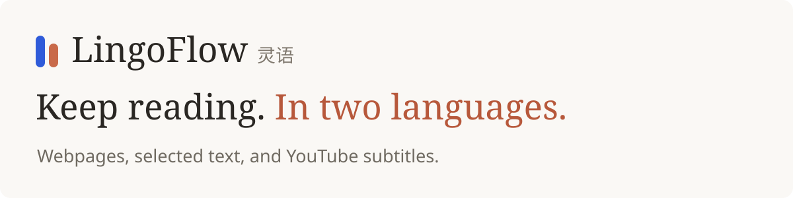

# LingoFlow · 灵语

[中文](README.md) · [English](README.en.md)

<p align="center">
  
</p>

**An open-source Chrome extension for bilingual reading.** Read webpages with the original text and translation together, translate selected text or hovered paragraphs, and follow YouTube with bilingual subtitles.

[**Download for Chrome →**](https://github.com/Guivyn/lingoflow/releases/latest) · [Installation](#install-and-start-reading) · [Report an issue](https://github.com/Guivyn/lingoflow/issues)

## Make it fit your reading

Choose your languages and provider, then switch between bilingual and translation-only display. Advanced controls expand when you need them.

<p align="center">
  
</p>

<details>
  <summary>View the dark theme</summary>

  <p align="center">
    
  </p>
</details>

## Start with a page in another language

- **Read whole pages.** Visible content takes priority; streaming providers display translations progressively while keeping the original text available.
- **Look up text as you go.** Translate selections or hovered paragraphs without leaving the page, with dictionary lookup and input suggestions.
- **Follow videos.** YouTube bilingual subtitles support sentence splitting and custom styles; AI-assisted segmentation is optional. [How subtitles work](docs/youtube-translation.md)
- **Set your defaults.** Website rules, dynamic-page observation, and optional automatic translation adapt the behavior to each site. [Automatic translation](docs/auto-translation.md)

## Install and start reading

1. Download <code>chrome.zip</code> from the [latest release](https://github.com/Guivyn/lingoflow/releases/latest) and unzip it.
2. Open <code>chrome://extensions</code>, enable **Developer mode**, and choose **Load unpacked**.
3. Select the extracted directory. Open a foreign-language page and click the extension icon, or press <code>Alt+S</code>.

The default configuration uses Microsoft's built-in endpoint. Other providers may require an API key or endpoint. To update an existing installation, replace the files in its original directory and reload that extension entry.

## Reliability and compatibility

Requests support background cancellation, bounded concurrency, and error-aware retries. Cache identities account for effective configuration and full context; expiry and entry limits are enforced. Settings, website rules, and floating-button preferences share save-failure feedback.

See the [cache policy](docs/cache-policy.md), [performance baseline](docs/performance/README.md), and [upstream compatibility](docs/upstream-integration.md). Performance measurements use a repeatable simulated service and do not establish real-provider speed gains. Local AI, audio transcription, PDF/EPUB/image translation, and plugin runtimes are not included.

Latest version: [Release notes](https://github.com/Guivyn/lingoflow/releases/latest). Existing local settings and rules retain their storage namespace across the major-version upgrade.

## Engines and configuration

- **Machine translation**: Google, Microsoft, DeepL, and DeepLX.
- **AI translation**: DeepSeek, OpenAI, and Custom, with streaming, batch aggregation, context, prompts, and hooks where supported by the selected interface.

See [docs/custom-api_v2.md](docs/custom-api_v2.md) for custom endpoints and hooks, and [docs/DESIGN.md](docs/DESIGN.md) for the interface design system.

## Shortcuts

| Chrome global shortcut | Action |
| --- | --- |
| `Alt+K` | Open the extension popup |
| `Alt+S` | Toggle whole-page translation |
| `Alt+C` | Toggle translation styles |

The active global bindings are shown in `chrome://extensions/shortcuts`. Page-level and selection shortcuts can be customized in the extension settings.

## Permissions and data

- LingoFlow requests `<all_urls>` so it can read and insert translations on arbitrary webpages; `storage`, `scripting`, and context-menu permissions support configuration, injection, and page actions.
- Translation text is sent to the provider you select. Endpoint, API-key, and data-retention policies vary by service.
- Configuration and translation caches are managed by browser-local storage. Do not put API keys in screenshots, Issues, or logs.

## Development

<!-- release-standard:start -->
**v2.0.1** · Node.js **22** · pnpm **11.18.0**
<!-- release-standard:end -->

The toolchain is defined by [`.nvmrc`](.nvmrc) and [`.pnpm-version`](.pnpm-version); the version block is generated from the release standard. See the [release standard](docs/release-standard.md).

```bash
git clone https://github.com/Guivyn/lingoflow.git
cd lingoflow
pnpm install
pnpm start       # local development, starting at the Options page
pnpm test        # unit tests
pnpm test:ci     # one non-interactive test run
pnpm lint        # ESLint
pnpm build       # build the Chrome extension into build/chrome/
```

Load `build/chrome/` in Chrome after building. Run `pnpm build+zip` to produce `build/chrome.zip`, its SHA-256 checksum, and a build report. [CI](https://github.com/Guivyn/lingoflow/actions/workflows/ci.yml) runs the checks and retains build artifacts.

## Contributing

- [Report a bug](https://github.com/Guivyn/lingoflow/issues/new?template=bug_report.md)
- [Request a feature](https://github.com/Guivyn/lingoflow/issues/new?template=feature_request.md)
- Use [Issues](https://github.com/Guivyn/lingoflow/issues) for other discussions.

## Acknowledgements

LingoFlow is based on core code from [fishjar/kiss-translator](https://github.com/fishjar/kiss-translator) (GPL-3.0). The page scanner, rule matching, translation renderer, YouTube subtitle pipeline, and UI design system were rewritten on top of that foundation.

## License

[GPL-3.0](LICENSE)
