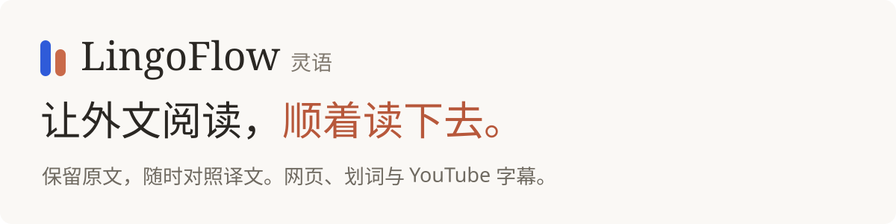
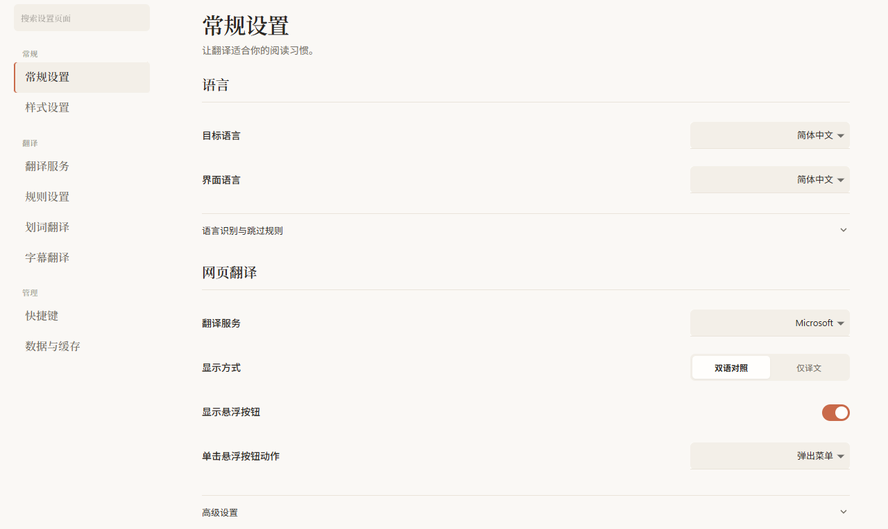
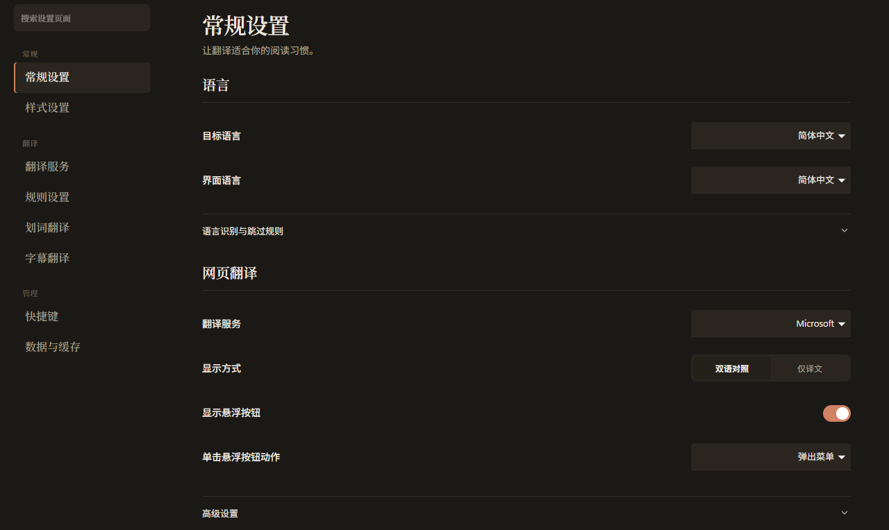

# LingoFlow（灵语）

[中文](README.md) · [English](README.en.md)

<!-- release-standard:start -->
**v2.0.0** · Node.js **22** · pnpm **11.18.0**
<!-- release-standard:end -->

[下载最新版](https://github.com/Guivyn/lingoflow/releases/latest) · [查看 CI](https://github.com/Guivyn/lingoflow/actions/workflows/ci.yml)

<p align="center">
  
</p>

LingoFlow 是一款轻量、开源的 Chrome 双语阅读扩展。它把网页、选中文本、悬停段落和 YouTube 字幕变成可以随时对照的双语阅读体验。

## 2.0.0 功能与改进

- 更新弹窗与设置导航，高级选项按需展开，支持减少动态效果，补齐六种界面语言的新增文案。
- 流式翻译优先处理可见内容与阅读顺序，首批提前发出；并发有上限，取消能传递到后台，重试按错误类型处理。
- 缓存按有效配置和完整上下文区分，读取时检查有效期，并限制条目数量。
- 通用设置、网站规则和悬浮按钮使用统一的保存失败反馈；大版本升级沿用现有存储命名空间，保留已有本地配置和规则。
- 接入兼容的 YouTube 字幕捕获、分句与菜单改进，参见 [字幕实现](docs/youtube-translation.md) 与 [上游兼容范围](docs/upstream-integration.md)。

[性能基线报告](docs/performance/README.md) 使用可重复的模拟服务，不代表真实翻译接口的实测提速。本版本未引入本地 AI、音频转写、PDF/EPUB/图片翻译或服务插件运行时。

## 界面预览

设置中心按语言、翻译服务、网站规则、字幕和数据管理分组。高级选项按需展开，浅色与深色主题使用一致布局。

<p align="center">
  
</p>

<details>
  <summary>查看深色主题</summary>

  <p align="center">
    
  </p>
</details>

## 30 秒上手

### 直接安装 Release 包（推荐）

1. 前往 [最新版 Release](https://github.com/Guivyn/lingoflow/releases/latest) 下载 `chrome.zip`。
2. 解压到任意本地目录，打开 `chrome://extensions` 并启用“开发者模式”。
3. 点击“加载已解压的扩展程序”，选择解压后的目录。
4. 打开任意外文网页，点击工具栏中的 LingoFlow 图标，或使用 `Alt+S` 切换整页翻译。
5. 选中文字后使用页面上的翻译悬浮球；打开 YouTube 视频后即可使用双语字幕功能。

当前默认配置使用 Microsoft 内置翻译端点，可先直接试用。选择其他服务时，请按服务要求填写 API Key、Endpoint 或本地服务地址。

### 从源码构建

构建环境以仓库的 [`.nvmrc`](.nvmrc) 和 [`.pnpm-version`](.pnpm-version) 为准，上方版本信息由 `pnpm sync-version` 自动生成。发布检查见 [交付规范](docs/release-standard.md)。

```bash
git clone https://github.com/Guivyn/lingoflow.git
cd lingoflow
pnpm install
pnpm build
```

构建产物统一输出到 `build/chrome/`，在 `chrome://extensions` 中加载该目录即可。发布打包使用 `pnpm build+zip`，产物为 `build/chrome.zip`。

## 使用场景

- **整页翻译**：自动扫描、规则匹配和 SPA 动态监听，保持文章主体的双语对照。
- **目标语言自动翻译**：检测非目标语言页面后，自动译为当前网页规则的目标语言；弹窗、页面内面板和设置中心共享开关。[行为说明](docs/auto-translation.md)
- **划词与悬停**：选中单词、短语或段落，使用行内译文、翻译框或悬浮气泡查看结果。
- **YouTube 字幕**：双语显示、句子切分、字幕样式和可选的 AI 分句增强。
- **词典与联想**：英文词典、输入联想和多翻译引擎对照。

## 工作方式

- 常见页面由自动扫描处理，复杂站点可以使用内置规则和 SPA 动态监听进行补充。
- 整页、划词和悬停分别使用适合阅读场景的呈现方式，互不挤在同一个弹窗里。
- 字幕翻译拥有独立的字幕处理管线；AI 分句是可选增强，不是使用 YouTube 字幕的前置条件。

## 翻译引擎与配置

- **机器翻译**：Google、Microsoft、DeepL、DeepLX。
- **AI 翻译**：DeepSeek、OpenAI、Custom，可按接口能力使用流式输出、批处理聚合、上下文记忆、Prompt 和 Hook。

自定义翻译接口的接入与 Hook 说明见 [docs/custom-api_v2.md](docs/custom-api_v2.md)。界面设计规范见 [docs/DESIGN.md](docs/DESIGN.md)。

## 快捷键

| Chrome 全局快捷键 | 作用 |
| --- | --- |
| `Alt+K` | 打开扩展弹窗 |
| `Alt+S` | 切换整页翻译 |
| `Alt+C` | 切换译文样式 |

全局快捷键以 `chrome://extensions/shortcuts` 中显示的绑定为准；页面级快捷键和划词快捷键可以在扩展设置中自定义。

## 权限与数据

- 扩展需要 `<all_urls>` 权限，才能读取并在任意网页中插入双语译文；`storage`、`scripting` 和右键菜单权限分别用于配置保存、页面注入和上下文操作。
- 翻译文本会发送给当前选择的翻译服务。不同服务的 Endpoint、API Key 和数据保留政策不同，请在启用前自行确认。
- 配置项和翻译缓存由浏览器本地存储管理；不要把 API Key 放进截图、Issue 或日志中。

## 开发

```bash
pnpm install
pnpm start       # 本地开发，入口为 Options 设置页
pnpm test        # 单元测试
pnpm test:ci     # 单次、非交互测试
pnpm lint        # ESLint
pnpm build       # 构建 Chrome 扩展，产物输出到 build/chrome/
```

## 反馈与贡献

- [报告 Bug](https://github.com/Guivyn/lingoflow/issues/new?template=bug_report.md)
- [提出功能建议](https://github.com/Guivyn/lingoflow/issues/new?template=feature_request.md)
- 其他讨论可以前往 [Issues](https://github.com/Guivyn/lingoflow/issues)。

## 致谢

LingoFlow 的核心代码借鉴自 [fishjar/kiss-translator](https://github.com/fishjar/kiss-translator)（GPL-3.0）。
我们在此基础上重写了页面扫描、规则匹配、译文渲染、YouTube 字幕管线与全新 UI 设计系统。
感谢 fishjar 与 kiss-translator 社区的开源贡献。

## 许可证

[GPL-3.0](LICENSE)
