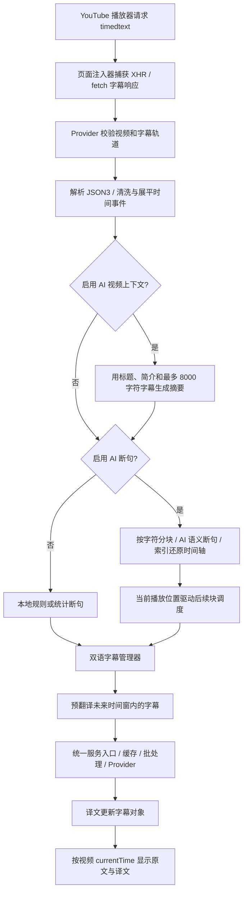

# LingoFlow 的 YouTube 字幕翻译流程

本文对应当前项目实现，不包含上游尚未接入的本地 ASR 和音频转写运行时。

## 1. 原文来自哪里

扩展注入 `injector-subtitle.js` 到 YouTube 页面上下文。注入器捕获 `/api/timedtext` 的 XHR 响应和 fetch 响应副本，通过原页面 origin 的 postMessage 传给 Content Script。不会读取或消耗播放器本来要用的 fetch body，也不会重复安装捕获包装器。

Provider 校验 origin、URL 路径、响应大小、视频 ID、字幕轨道与处理版本。它读取 captionTracks，优先匹配用户选择的语言和手动/自动字幕轨；已有响应可直接使用，否则请求 JSON3 原文轨道，避免把 YouTube 自己翻译后的字幕当作原文。

这里的自动字幕轨 `kind=asr` 是 YouTube 已生成的自动字幕，不等于扩展在本机识别音频。当前没有音频识别兜底：无法取得可用字幕时，不能保证为无字幕视频生成字幕。

## 2. 为什么需要分段

JSON3 往往是细小事件和带偏移的词片段，不是适合阅读的完整句子。处理层清洗标签、零宽字符、重复事件和非语音片段，转成带 start/end 毫秒时间的事件。

未启用 AI 断句时，本地规则根据标点、停顿和长度合并，或使用统计断句。兜底按原有单词时间边界、时长、词数和字符数切分；不会为了均分文本而伪造均匀时间轴。单个不可再分的词/事件仍可能超过上限。

启用 AI 断句时，按 `chunkLength` 分块（默认约 1000 字符），把带稳定事件索引的文本交给模型。程序校验返回的连续索引覆盖，并从原始事件重建时间；后续块按播放位置及预翻译窗口按需调度，不默认一次处理完整视频。AI 失败时会按当前策略回退本地分段。

AI 断句通常同时返回译文。不同断句/翻译服务搭配且开启“强制重翻”时，分段译文作为草稿，再交给所选翻译服务处理。

## 3. AI 上下文与 AI 断句是两件事

可选的 `aiContextSlug` 用标题、完整简介和字幕前 8000 字符生成视频摘要；字幕少于约 200 字符时跳过。摘要帮助后续请求理解主题、专有名词和代词，不能创造字幕中没有的事实。启用它可能增加一次模型请求和启动等待。

`segSlug` 控制 AI 断句；`apiSlug` 控制字幕翻译。三者可以分别配置，不是同一个开关。手动翻译模式会先准备原文，再等待用户从菜单开启翻译。

## 4. 翻译什么时候发送

`BilingualSubtitleManager` 根据当前播放时间定位字幕，并预翻译后方一段时间的内容。`preTrans` 默认 90，单位是秒；`throttleTrans` 默认 30，单位也是秒。前者决定提前多远准备，后者限制周期性触发频率。首次同步、跳转后的同步和块增量追加也会触发必要的调度。

每条尚未完成的字幕进入统一 `apiTranslate`，复用配置身份缓存、接口请求池、批处理、错误分类和取消机制。传统服务通常整条返回；AI 实时流式服务可逐步更新当前字幕译文。网络的 SSE 首 token 与屏幕可读首词是两个指标，还隔着协议解析和渲染。

## 5. 如何和画面同步

字幕对象保留 `{start, end, text, translation}`。视频时间以秒给出，管理器转成毫秒后用二分查找当前字幕，按双语/仅译文、顺序和样式渲染，更新侧边字幕列表，并支持下载双语 VTT。

拖动进度条时取消旧节流，立即重新定位，并在动画帧再次确认位置。字幕时间取自 YouTube 事件，不按模型生成速度推算。

切换视频、字幕轨或语言时，处理版本和翻译会话递增，并中止旧请求；旧会话的异步回调不会写入新视频。缓存命中可减少重复请求，但缓存过期、接口配置改变或上下文改变后会按统一身份与有效期规则重新计算。

## 6. 可能感到慢的原因

- 刚打开视频尚未触发播放器字幕请求，或者字幕轨道请求失败。
- 开启 AI 上下文或 AI 断句，多了模型处理阶段。
- 翻译服务本身首词慢、限流或需要重试。
- 已跳转到预翻译窗口外，当前位置的字幕还未准备。
- 视频无可用字幕；这属于缺少原始数据，不能用增加并发解决。
